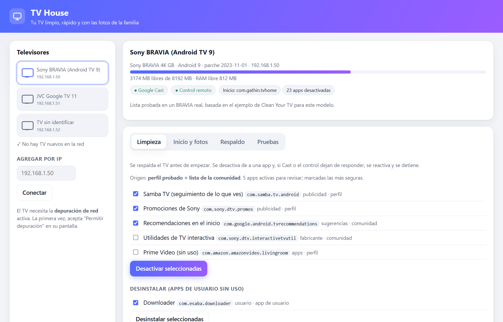
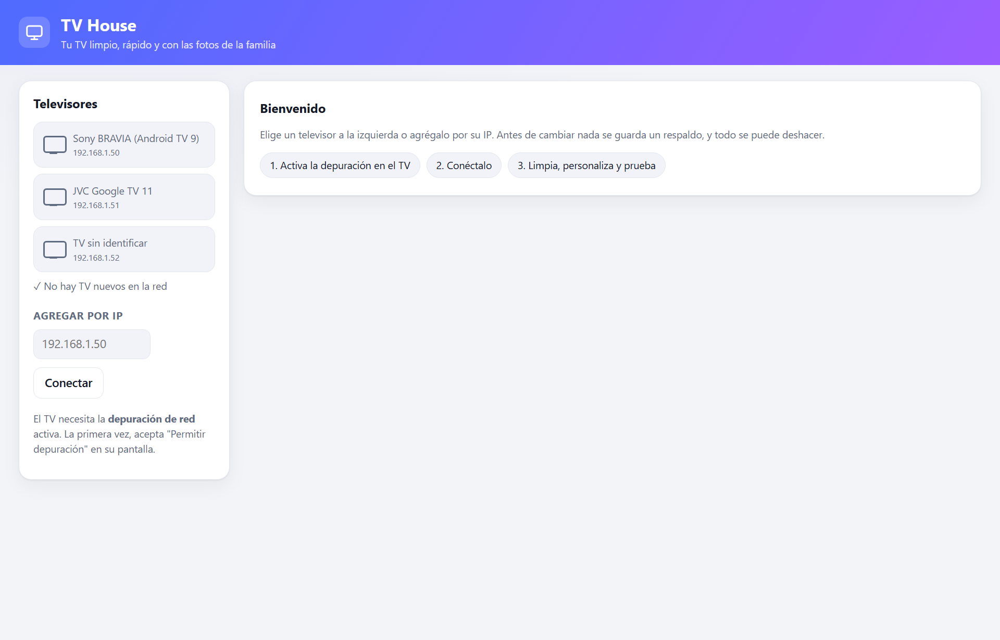
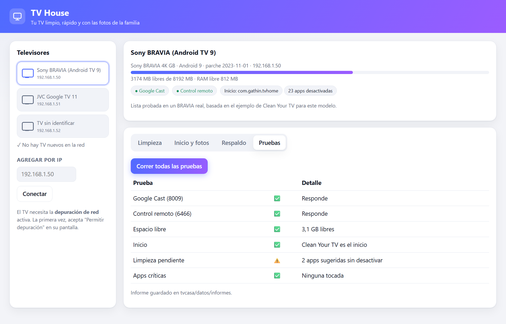
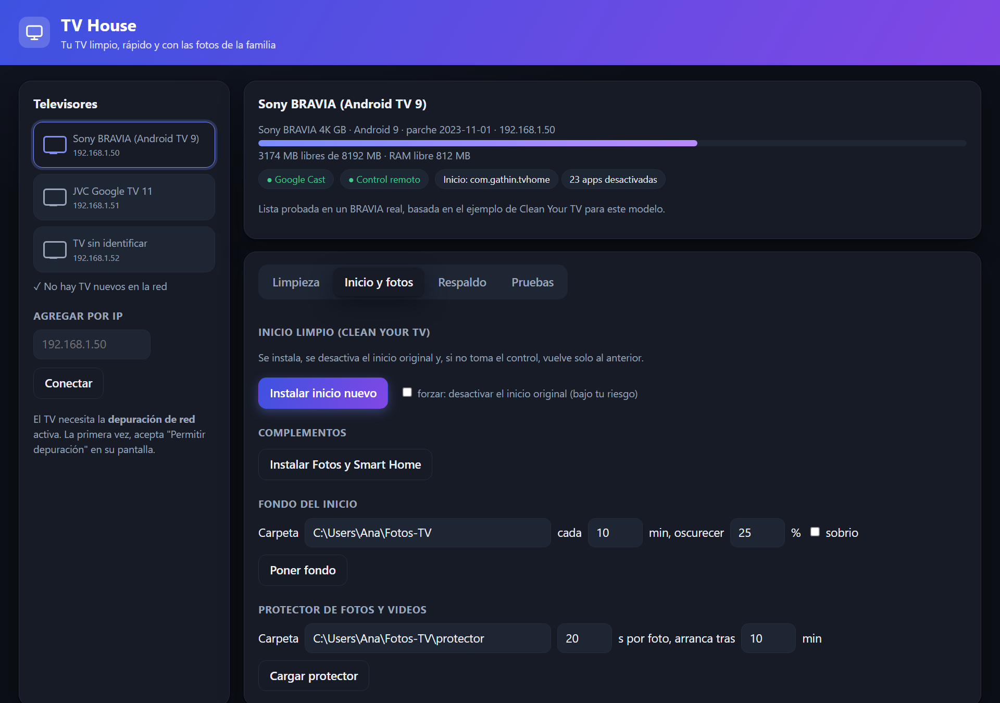

# TV House

Configura los **Android TV / Google TV** de cualquier casa por la red, sin depender de la IA:
limpieza de apps, inicio limpio estilo Apple TV, fondo y protector de fotos y videos, respaldo y vuelta atrás, y un
informe de pruebas. La IA solo se usa si aprietas **"Consultar a Claude"** ante un error o una duda.

Funciona en **Windows y Mac**. Samsung (Tizen), LG (webOS) y otros sistemas: pendiente, ver "Próximos pasos".



| Al abrir | Informe de pruebas |
|---|---|
|  |  |



*Capturas con datos de ejemplo. La app se pone en modo claro u oscuro sola, según Windows o Mac.*

## Instalar

1. Python 3.10 o más nuevo ([python.org](https://www.python.org/downloads/)).
2. Descarga el repo (botón **Code → Download ZIP**, o `git clone`) y, en esa carpeta:
   - Windows: `powershell -ExecutionPolicy Bypass -File instalar.ps1`
   - Mac: `bash instalar.sh`

   Crea su propio entorno de Python, instala `anthropic`, `pillow` y `pywebview`, baja ADB oficial de Google (verifica la firma en
   Windows) y **corre las pruebas automáticas**. Si alguna falla, no deja abrir la app.
3. Abrir:
   - Windows: ícono **TV House** en el escritorio o el menú Inicio. Abre su **propia ventana** (Edge WebView2, que ya
     trae Windows 11), sin navegador ni consola. Los botones "Elegir…" abren el explorador para escoger carpetas.
   - Mac: doble clic en `abrir-tvhouse.command` (ventana propia con WebKit).
   - Si se prefiere el navegador: `python -m tvcasa --navegador` (queda en `http://127.0.0.1:8765`, solo esta computadora).

En cada TV: **Ajustes → Sistema → Acerca de → 7 clics en "Compilación"**, luego **Opciones para desarrolladores →
Depuración de red / USB**. La primera conexión pide aceptar "Permitir depuración" en la pantalla del TV.

## Qué hace

| Pestaña | Qué hace | Seguridad |
|---|---|---|
| Limpieza | Propone qué desactivar y lo hace de a una | Respaldo antes; tras cada app comprueba Google Cast (8009) y el control remoto (6466); si algo se rompe, la reactiva y se detiene. Nunca desinstala apps del sistema |
| Inicio y fotos | Inicio limpio (Clean Your TV), complementos Fotos y Smart Home, fondo con fotos, protector de fotos y videos | Si el inicio nuevo no toma el control, vuelve solo al original. En Google TV solo con "forzar" |
| Respaldo | Guarda el estado y vuelve a cualquier respaldo | Reactiva lo desactivado después, devuelve inicio y protector |
| Pruebas | Cast, control, espacio, inicio, limpieza pendiente, nada crítico tocado | Informe `.md` y `.json` en `datos/informes` |

### De dónde sale la propuesta de limpieza (cualquier TV)

1. **Perfil probado en casa** (`tvcasa/perfiles/`): Sony BRAVIA (Android TV 9), JVC/Changhong y JVC/KTC (Google TV 11).
2. **Lista de la comunidad para el mismo modelo**: 307 modelos de 87 marcas de
   [Clean Your TV](https://github.com/Gathin23/cleanyourtv) (MIT), en `tvcasa/catalogo/`.
3. **Catálogo general**: lo que el TV tiene activo y que otros modelos ya desactivaron. Marcado solo si lo hicieron
   20+ modelos; las apps que se ven en el inicio (Netflix, YouTube…) van **siempre sin marcar**.

En los tres casos se descarta lo de la lista **NUNCA** (`perfiles.py`): Google Play, Cast, control remoto, asistente,
sintonizador/HDMI, configuración, inicio original, teclados, Bluetooth, actualizaciones, menús de fábrica…

Actualizar el catálogo: `python herramientas/importar_catalogo.py <carpeta del repo cleanyourtv>`.

## Consultar a Claude

Opcional. Necesita una clave de Anthropic en la variable `ANTHROPIC_API_KEY` (o `ant auth login`) **antes** de abrir
la app; la app no la guarda. Manda la pregunta, el estado del TV y el registro de la acción, **sin MAC, tokens ni
contraseñas** (se borran antes). Modelo `claude-opus-5-5`; cuesta centavos por consulta.

## Por línea de comandos

```
.venv/Scripts/python -m tvcasa pruebas 192.168.1.50     # Windows (Mac: .venv/bin/python)
.venv/Scripts/python -m tvcasa info 192.168.1.50
.venv/Scripts/python -m unittest discover -s pruebas    # pruebas automáticas (TV simulado)
```

## Al terminar

Apagar la **depuración de red** en cada TV: mientras está activa, cualquier equipo de la red puede controlarlo.

## Próximos pasos

- Samsung Tizen / LG webOS: otro "conector" con el mismo esquema (perfil, propuesta, verificación, respaldo).
- Video de fondo en el inicio (hoy el video va en el protector Fotos).
- Programar fotos por fecha (Navidad, cumpleaños) desde la app.

## Aviso

Úsala bajo tu propio riesgo. Desactiva apps del sistema (nunca las desinstala) y siempre guarda un respaldo antes,
pero cada fabricante es distinto. "Consultar a Claude" usa tu propia clave de la API de Anthropic. ADB no viene
incluido: el instalador lo baja de Google. Licencia MIT (ver `LICENSE`).

## Apoya el proyecto

TV House es gratis y de código abierto. Si te ahorró tiempo o dejó tu TV como nuevo, puedes apoyarlo en
[GitHub Sponsors](https://github.com/sponsors/tutvcasa23-star). Con eso se compran TVs de otras marcas para probar
y se agregan Samsung y LG.
